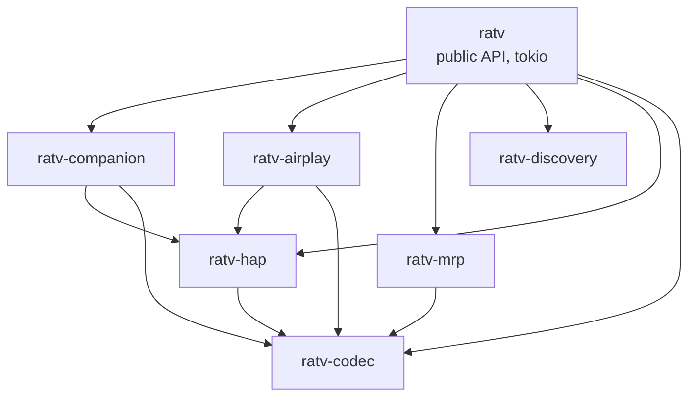
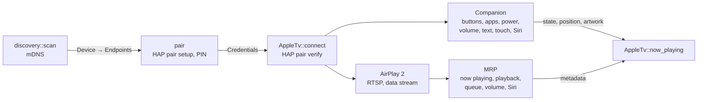

# Architecture

Dependencies between the crates (an arrow means "uses"):

The `companion`, `discovery` and `mrp` features turn on the optional
crates. `ratv-hap` is always used.

How a client uses them. Pairing runs one time. Keep the `Credentials` for
later connections.

